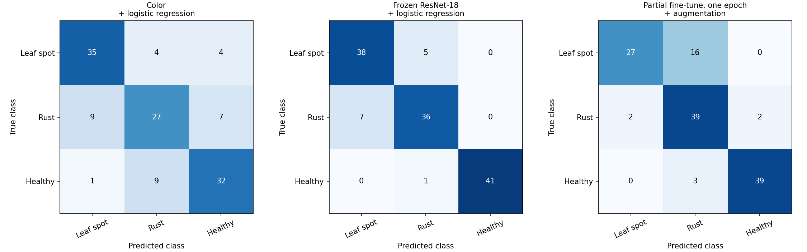
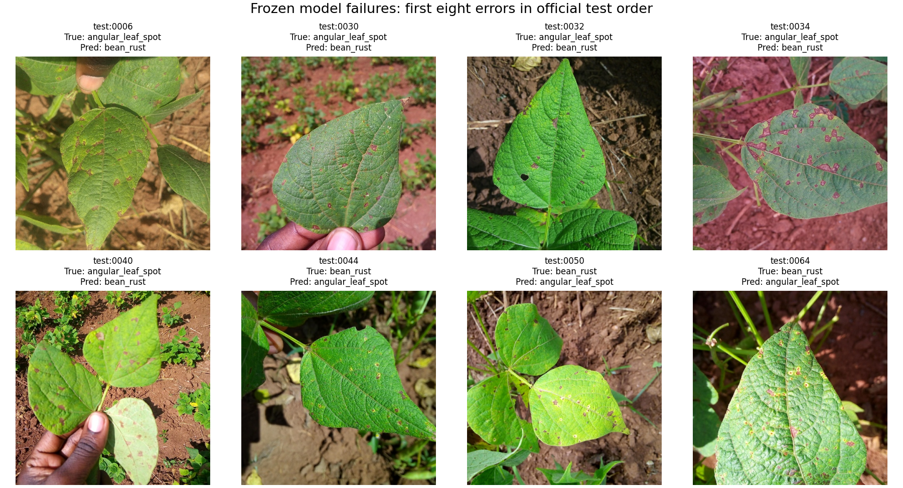
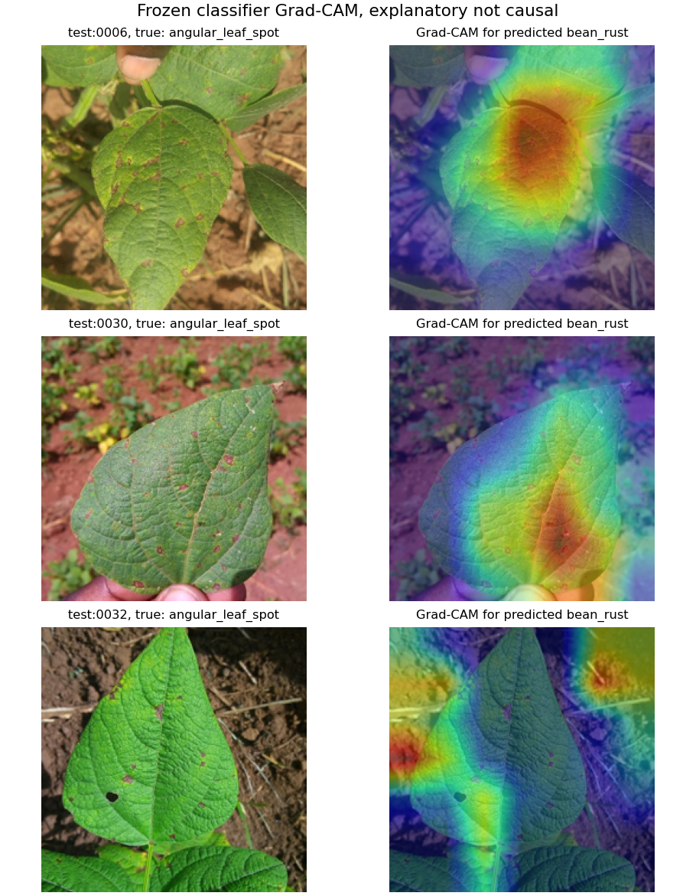

# Bean Leaf Transfer Learning

[](https://github.com/MoustafaMZaalouk/bean-leaf-transfer-learning/blob/main/.github/workflows/ci.yml)

*Live workflow status, not a production-readiness or model-quality rating.*

A small, AI-assisted portfolio project prepared for Moustafa Zaalouk. It compares simple color statistics with pretrained image features on real public bean-leaf photographs. It includes a deliberately limited fine-tuning experiment, including its worse result, rather than assuming a more complex model wins.

**Status:** local research demo, not a plant-disease diagnostic tool. No cloud account, paid API or GitHub publishing is needed. Moustafa should review, run and explain the code before presenting it as his work.

## Measured results

Official Hugging Face splits, unchanged: 1,034 training, 133 validation and 128 test images. Class order is angular leaf spot, bean rust, healthy. These values are recomputed by `scripts/evaluate.py` from the committed `reports/predictions.json`, and checked against `reports/metrics.json`:

| Method | Test correct | Accuracy | Macro F1 |
|---|---:|---:|---:|
| Color features + logistic regression | 94/128 | 0.7344 | 0.7330 |
| Frozen ResNet-18 features + logistic regression | 115/128 | 0.8984 | 0.8995 |
| Final-stage partial fine-tuning, one epoch + augmentation | 105/128 | 0.8203 | 0.8207 |

See [generated evaluation](reports/RESULTS.md) for per-class precision/recall and 95% Wilson confidence intervals, and `reports/evaluation.json` for machine-readable intervals, including accuracy. These intervals describe binomial sampling uncertainty conditional on a fixed model. They do not include training-seed uncertainty or account for correlated field images.



The frozen method makes most of its errors between the two disease classes. Its higher result here does not establish that frozen features are generally better than fine-tuning. The fine-tune budget is just one epoch, with no learning-rate sweep. Augmentation and classifier type also differ, so this is a practical recipe comparison, not an isolated causal ablation.

## Reproduce

Tested on Linux x86_64, Python 3.10.12, CPU only. Use Python 3.10 and allow roughly 2 GB RAM plus disk for data, weights and dependencies. Other platforms may need a compatible PyTorch build; exact float results across different libraries/hardware are not promised.

```bash
python3.10 -m venv .venv
. .venv/bin/activate
python -m pip install -r requirements.txt
make train && make eval
make lint test
```

The final two training/evaluation steps are one command: `make train && make eval`. First run downloads roughly 180 MB of data plus ResNet weights and takes longer than a warm-cache run. No token is required. Dataset and model revisions are pinned in `src/beanleaf/core.py`. Dependencies, including transitive packages, are version-pinned; the exact installed environment is recorded in `reports/environment.json` and `reports/environment-freeze.txt`. There is no vendored full dataset or model checkpoint in this archive. A fresh isolated-environment run with newly extracted features reproduced byte-identical predictions; see [verification record](reports/REPRODUCTION.md).

- `make train`: extract features, fit the training-only classifiers, audit splits, run partial fine-tuning and save predictions. Seed 42; deterministic PyTorch operations; four CPU threads.
- `make eval`: verify saved predictions against recorded metrics, compute confidence intervals and regenerate all plots. This works offline from the included reports.
- `make smoke`: actual training on six images per class per official split, writing only `.smoke-reports/`. It still downloads the pinned full parquet files, but only extracts features and trains on the subsample. Smoke metrics are not headline results.
- `make lint test`: four-space formatter check, lint and correctness tests. CI runs these and `make smoke`. The published source passed hosted lint, tests and smoke training in [GitHub Actions](https://github.com/MoustafaMZaalouk/bean-leaf-transfer-learning/actions/runs/45293237274). Later run status is visible in the Actions tab.
- `make clean-cache`: discard local feature arrays after changing extraction code or dependencies. Data and pretrained model downloads remain cached.

## How it works, in plain language

1. Load the dataset's own splits and decode images as RGB. Do not create a random split from all images. Verify schema, labels, aligned lengths and unique record IDs.
2. For the color baseline, resize to 128 by 128 and summarize each RGB channel by mean, standard deviation and an eight-bin histogram. This produces 30 numbers but loses leaf shape and lesion location.
3. For transfer learning, use the checkpoint's own image processor and run ResNet-18 in evaluation mode with gradients disabled. Its globally pooled output is a 512-number description of an image. **This is frozen feature extraction, not fine-tuning.**
4. Fit a scaler and multiclass logistic regression using training images only. Choose regularization C from `[0.001, 0.01, 0.1, 1, 10]` using validation macro F1; ties keep the smaller C. Do not refit on validation. Evaluate once on the test split after this selection.
5. Separately unfreeze only ResNet's last residual stage and attach a new three-class linear head. Run one epoch with AdamW, backbone LR 0.0001, head LR 0.001, weight decay 0.01, batch size eight. Use train-only horizontal/vertical flips and brightness factor 0.85 to 1.15. Keep BatchNorm running statistics fixed. There are 8,395,267 trainable parameters, including the head. Earlier stages remain frozen. This is **partial** fine-tuning, not full-network fine-tuning.
6. Count correct predictions, compute macro F1 and per-class metrics, then inspect mistakes. The scripts save individual test predictions so the numbers can be audited without rerunning a neural network.

## Failures and explanation



The panel shows the first eight frozen-model mistakes in official test order, not a curated best-looking sample. It is descriptive; a label mismatch is not proof the label is wrong.



Grad-CAM targets the frozen learned classifier's **predicted-class logit**, backpropagated through its scaler, logistic weights and final spatial ResNet stage. It does not explain the original ImageNet head. The overlay uses the processor's actual center-cropped input geometry. Colors are independently normalized per image. These panels are not causal evidence and cannot prove the model used disease-specific cues.

## Leakage and limitations

`reports/duplicate_audit.json` reports **zero decoded-pixel exact cross-split pairs** and **zero dHash candidates** with Hamming distance at most four. Hashes compare every cross-split image pair. dHash is a heuristic, not a guarantee: crops, rotations, similar leaves, same-plant photos and field-level correlations may be missed. Split-qualified IDs identify rows, not unique plants. No plant/farm grouping metadata is available in this workflow. We cannot rule out overlap with ImageNet pretraining.

Other limits: small test set; one seed; no external farm, phone or season test; no calibrated probabilities; no deployment timing or memory benchmark; no fairness analysis; no farmer usability validation. The fine-tune recipe is intentionally low-budget, not a tuned upper bound. Do not use this demo to recommend treatment. Failure photographs are dataset excerpts with the dataset attribution/license below.

## Files

```text
src/beanleaf/core.py        data, validation, features, audit, model selection, metrics
src/beanleaf/finetune.py    augmentation, partial fine-tuning, Grad-CAM
scripts/run_experiment.py   reproducible experiment entry point
scripts/evaluate.py         metrics, confidence intervals and every plot
reports/                    committed predictions, measured metrics, figures and provenance
tests/test_correctness.py   known-answer and behavioral correctness tests
.github/workflows/ci.yml    lint, tests, real subsample training
```

Tests check hand-calculated confusion matrix/F1 and histogram values, Wilson intervals, train-only scaler fitting, selection scores, exact duplicate detection, frozen weights and BatchNorm buffers, allowed fine-tune parameter changes, deterministic augmentation, Grad-CAM zero-score behavior/hook cleanup, bad labels/schema/ID overlap rejection, and consistency of all committed predictions with metrics.

## Credits and separate licenses

**Project code:** MIT, see [LICENSE](LICENSE). This license covers this project's authored code, not a blanket relicensing of datasets, pretrained weights or dependencies. AI assistance was used to write code, documentation and tests; results came from actual local execution.

**Dataset:** Makerere AI Lab / AIR Lab Makerere University, in collaboration with Uganda's National Crops Resources Research Institute (NaCRRI). The upstream README describes field smartphone photographs in Uganda and expert NaCRRI annotation. Dataset MIT license, copyright 2020 AIR Lab Makerere University. The upstream README explicitly labels the **data** MIT, and the repository contains an MIT LICENSE. The Hugging Face card's metadata also says MIT, though its prose Licensing Information section is incomplete. Verified against current source pages on 2026-11-24; see [license evidence](reports/LICENSE_EVIDENCE.md) and [original dataset license notice](reports/DATASET_LICENSE.txt).

- Dataset: https://huggingface.co/datasets/AI-Lab-Makerere/beans
- Upstream: https://github.com/AI-Lab-Makerere/ibean
- Data citation: Makerere AI Lab. *Bean disease dataset*. January 2020. https://github.com/AI-Lab-Makerere/ibean/
- Upstream README lists 1,296 images, while the pinned HF splits total 1,295. This project reports and uses the actual HF split counts, not the upstream aggregate.

**Pretrained model:** `microsoft/resnet-18`, Apache-2.0 according to its model card, pretrained on ImageNet-1k. Hosted by Microsoft; the model card was written by the Hugging Face team. ResNet architecture: Kaiming He, Xiangyu Zhang, Shaoqing Ren and Jian Sun, *Deep Residual Learning for Image Recognition*, 2015/2016. https://arxiv.org/abs/1512.03385 . Checkpoint and license metadata: https://huggingface.co/microsoft/resnet-18 . No pretrained weights are redistributed here. Apache-2.0 text: https://www.apache.org/licenses/LICENSE-2.0 . ImageNet is a separate source dataset, not created or relicensed by this project.
